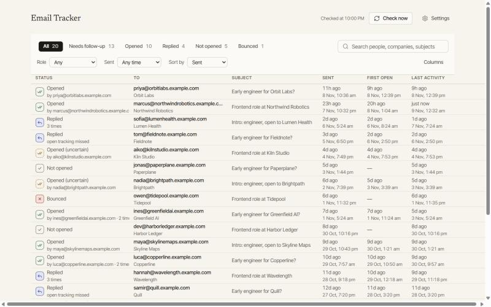
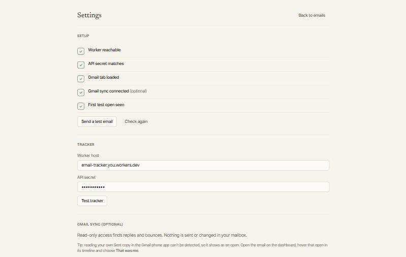

# Email Tracker

A private open tracker for cold email sent from Gmail. A Chrome extension adds a hidden 1×1 image when you send; a tiny Cloudflare Worker that you own records when it loads; the dashboard shows who opened, who replied and who needs a nudge.

Your recipients, subjects and notes stay in your browser. The Worker only ever sees random tokens and open events.



*The dashboard with the fake emails from `npm run demo-data`.*



*Settings: a live setup checklist, and a test email that turns the last check green.*

## Why this exists

I built it during a job search. Cold email to founders, hiring managers and recruiters works only if you know what happened next: did anyone open it, did anyone reply, which version of the pitch is landing, who is worth one follow-up. Hosted trackers answer that by keeping your whole recipient list on their servers. I wanted the answer without handing over the list.

## What it does

- **Tracks opens from Gmail.** The pixel is added when you press Send. If anything fails, the email still sends and you see a "not tracked" warning.
- **Tells real opens from noise.** Each open is classed as human, uncertain (Apple Mail Privacy Protection, Outlook proxies, your own phone in the first 10 minutes), automated (security scanners) or you.
- **Finds replies and bounces** (optional, read-only Gmail access). A reply outranks an open, even when no open was recorded: "Replied (open tracking missed)".
- **Says who engaged** when an email goes to several people: "Replied (Priya)".
- **Nudges follow-ups** only for emails that were opened and have no reply.
- **Notifies you** on the first real open, and on a re-open after an hour. Off by default; your own view of the Sent copy cancels it.
- **Shows chips in Gmail's Sent list** ("Opened 3×", "Replied") and warns in plain-text compose, where tracking can't work.
- **Protects your Worker:** duplicate fetches within 5 seconds count once, a per-source hourly cap stops abuse, and events are deleted after 90 days (configurable).
- **Keeps you in control:** a live setup checklist, "Delete all my local data", "Delete all Worker events", and Export/Import between browser profiles.
- **Experimental:** "Separate" opens one draft per recipient so each person's open is counted on its own.

## Set it up

You need Node.js, Chrome, and a free [Cloudflare account](https://dash.cloudflare.com/sign-up).

```bash
git clone https://github.com/<you>/email-tracker.git
cd email-tracker
npm run setup
```

`npm run setup` installs dependencies, logs you in to Cloudflare, creates the database, deploys the Worker with fresh secrets, generates your own extension key, and builds the extension with the Worker address and secret already filled in. It is safe to run again.

Then open `chrome://extensions`, turn on Developer mode, choose **Load unpacked**, and pick `extension/dist`. Open the extension's Settings and press **Send a test email**: the last check turns green when the open arrives.

Want to look around first? `npm run demo-data` loads about 20 fake emails (opens, replies, a bounce) into the dashboard. Remove them with **Delete all my local data**.

Reply and bounce detection is optional and off by default. Settings has a walkthrough that shows your extension ID for the Google Cloud OAuth client. The manual, step-by-step version of everything is in [docs/setup-guide.md](docs/setup-guide.md).

## Privacy

| Where | What it holds |
|---|---|
| Your browser (`chrome.storage`, IndexedDB) | Recipients, subjects, company and role tags, replies, bounces |
| Your Cloudflare Worker and D1 database | Random tokens, and for each open a timestamp, user agent, network name, country and a salted hash of the IP |
| Anywhere else | Nothing. No telemetry, no accounts, no hosted service |

The Worker never stores names, email addresses, subjects or raw IPs. Gmail access, if you enable it, is read-only and used only to find replies and bounces.

## How it compares

| | This project | Hosted trackers (Mailtrack and similar) | Other open-source trackers |
|---|---|---|---|
| Recipient data | Stays in your browser | On their servers | Varies; several store recipient addresses and IPs |
| Where events live | Your own Worker | Their servers | Your server or Worker |
| Noise handling | Four-way open classification | Varies | Often a single bot filter |
| Replies and bounces | Gmail API, read-only | Yes | Rarely |
| Cost | Free Cloudflare plan | Free tier, then paid | Free, more setup |

This comparison is from public READMEs and vendor pages and is not exhaustive. See [docs/research/competitors.md](docs/research/competitors.md).

## Limits

- **Apple Mail Privacy Protection** preloads images, so some opens are not real. They show as "uncertain".
- **Gmail's image proxy** may cache the pixel, so the repeat-open count is a minimum. The first open is the reliable signal.
- **Forwards** can't be counted or attributed.
- **Desktop Chrome and Gmail on the web only.** No mobile or other mail clients.
- **Gmail changes its markup** without notice. Every selector lives in one file, `extension/src/content/gmail-dom.ts`, so fixes are small.
- **Separate send** loses attachments and rich formatting, because each copy is a fresh draft.

## Roadmap (not built)

- Signed or rotating pixel IDs
- Link tracking
- Forward detection
- A portfolio-visit beacon

## Project layout

- `extension/`: Chrome MV3 extension (TypeScript)
- `worker/`: Cloudflare Worker and D1 migrations
- `design/`: design system
- `docs/`: decisions, specs and the setup guide

## License

[MIT](LICENSE). Shared as is: pull requests are welcome, with no support promises. See [CONTRIBUTING.md](CONTRIBUTING.md).
